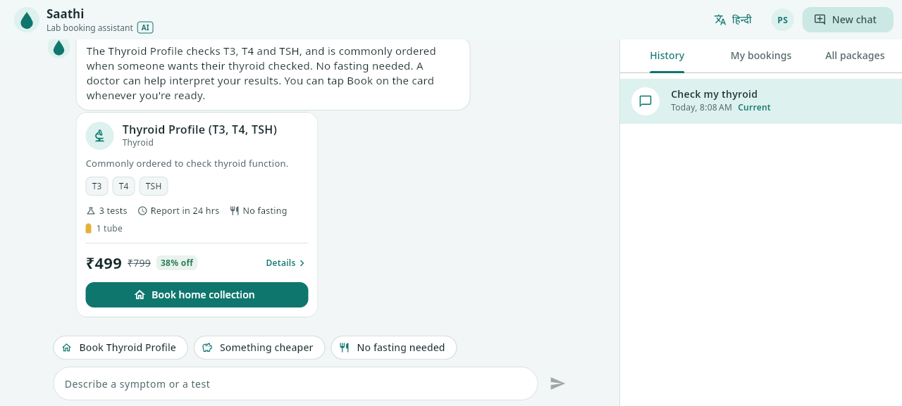
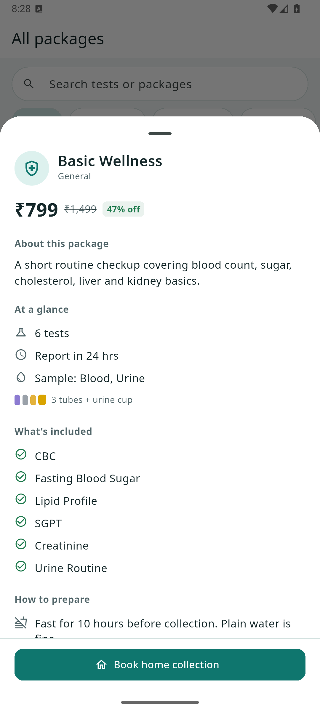
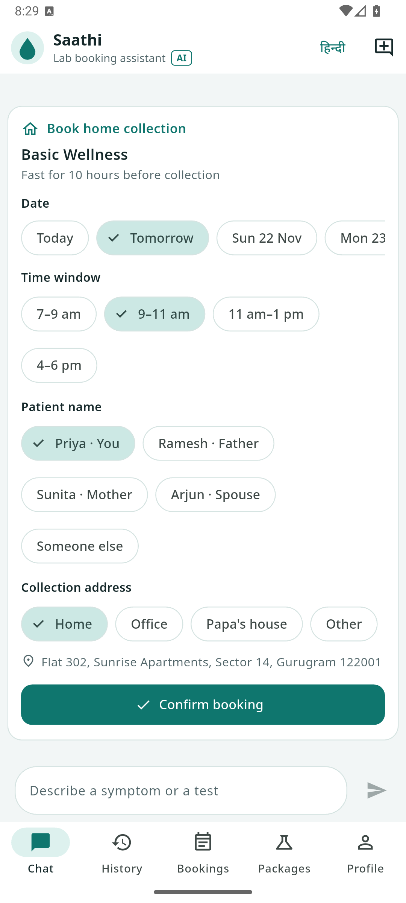
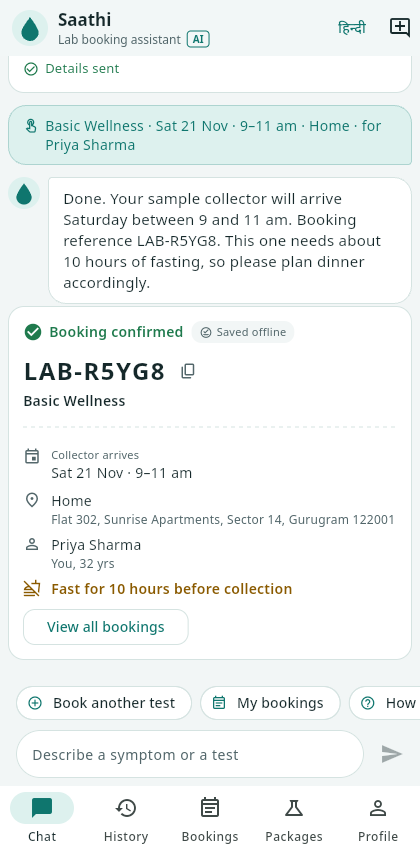
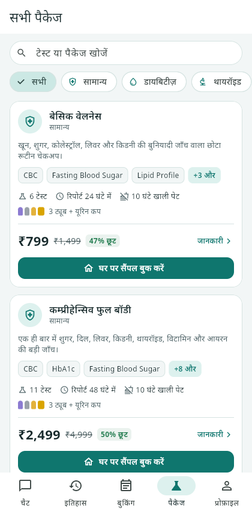
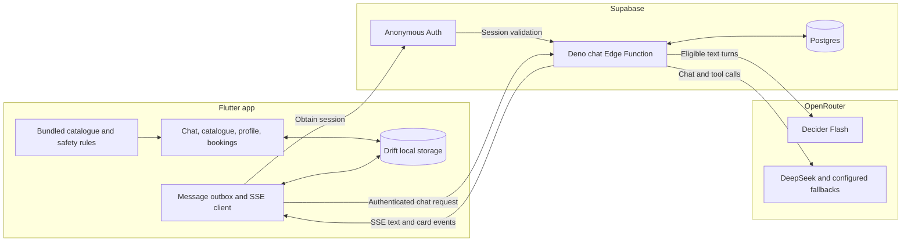
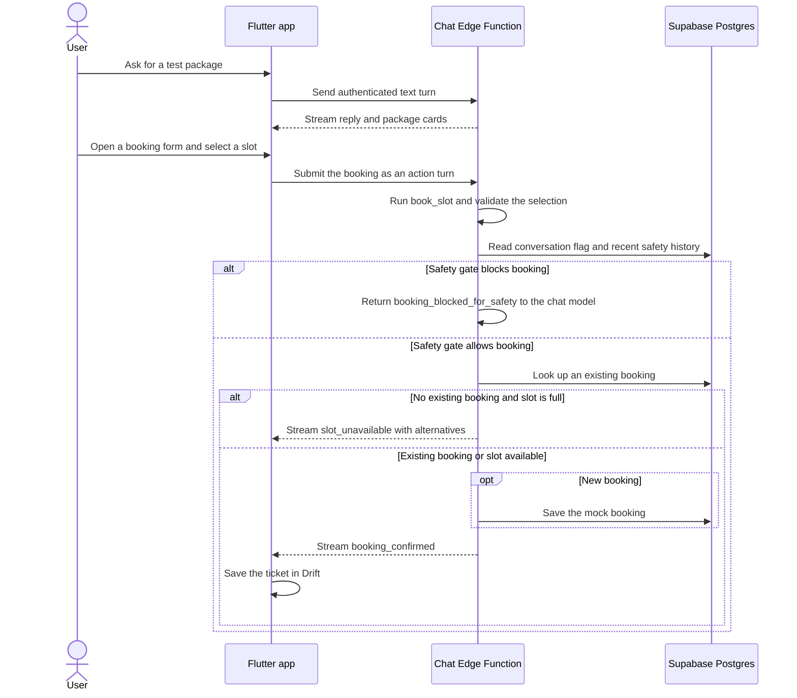
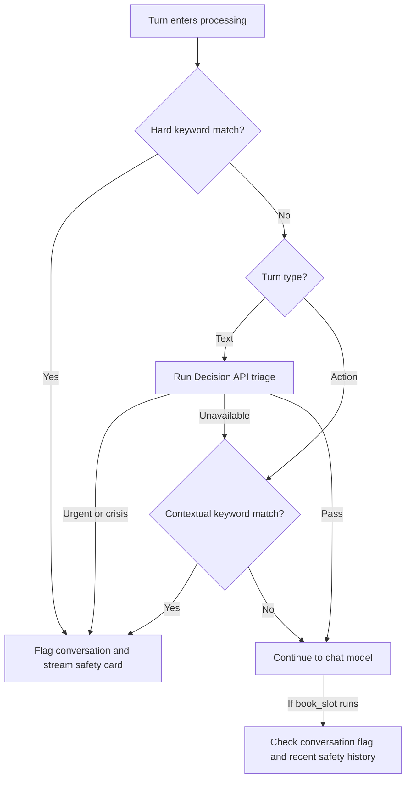

# Saathi

**Saathi (साथी) is an English and Hindi lab-booking companion.** Find a test package in conversation or in the catalogue, choose a patient and an address, and book a simulated home sample collection.

[Open the web demo](https://amansikarwar.dev/booking-bot/) · [Download the Android demo APK](https://github.com/AmanSikarwar/booking-bot/releases/tag/v0.1.2) · [View CI runs](https://github.com/AmanSikarwar/booking-bot/actions/workflows/ci.yml)

The demo uses a synthetic catalogue, sample profiles and addresses, and simulated appointment availability. Use sample information when trying it. A confirmation creates a demo booking record.



[Try the demo](#try-the-demo) · [Screenshots](#screenshots) · [Architecture](#architecture) · [Safety and offline behavior](#safety-and-offline-behavior) · [Developer setup](#developer-setup) · [Tests and evaluations](#tests-and-evaluations) · [Releases](#releases)

## Try the demo

1. Choose **Check my thyroid**, ask for a **Sugar test for Papa**, or open **Packages** to browse the 15-package catalogue.
2. Tap a package to see the included tests, price, fasting instructions, report time, and sample requirements.
3. Choose **Book home collection**. Select a date, time window, patient, and saved address. If the slot is full, Saathi offers alternatives.
4. Open **Bookings** to see the confirmation and its reference. Open **History** to return to a previous conversation.
5. Switch to **हिन्दी** from the chat header. Catalogue labels, interface copy, and the assistant's reply language switch with it.

On phones, the bottom bar opens Chat, History, Bookings, Packages, and Profile. Desktop uses a side panel for history, bookings, and the catalogue, with the profile available from the header. The seeded sample profile includes family members and saved addresses and can be edited or reset.

## Screenshots

The desktop screenshot is from the deployed web demo. The mobile screenshots show the native app running on an Android 16 emulator.

<table>
  <tr>
    <th scope="col">Package details</th>
    <th scope="col">Booking form</th>
  </tr>
  <tr>
    <td></td>
    <td></td>
  </tr>
  <tr>
    <th scope="col">Booking confirmation</th>
    <th scope="col">Hindi catalogue</th>
  </tr>
  <tr>
    <td></td>
    <td></td>
  </tr>
</table>

## Architecture

The Flutter app reads from local Drift storage. Its outbox sends user messages to Supabase and applies streamed events to local records. Package ranking and booking validation run in the Edge Function. The models interpret text and choose tools, while application code owns catalogue prices, slot availability, and booking writes.



| Layer | Implementation |
| --- | --- |
| Flutter UI | Material UI, responsive layouts, BLoC, typed `go_router` routes, English and Hindi strings generated by `slang` |
| Device storage | Drift with SQLite on native platforms and SQLite WASM on web. Conversations, cards, bookings, profile data, and queued messages are stored locally |
| Edge Function | Deno and TypeScript. Validates sessions, conversation ownership, turn input, tool arguments, and booking constraints |
| Backend storage | Supabase Postgres. Stores conversations, messages, bookings, safety decisions, and model usage. Row-level policies limit authenticated reads of conversation and booking data to the owner |
| Models | DeepSeek as the default chat model and Decider Flash for triage. Defaults and overrides are in [the function entry point](supabase/functions/chat/index.ts) and [`.env.example`](.env.example) |

### How a booking works

The chat agent has three tools. `search_packages` returns ranked catalogue matches. `show_booking_form` provides a native form and available windows when the user asks to book. `book_slot` validates the selection and applies the safety gate before looking up or creating a mock booking. Package cards can also open the form directly on the device. This example follows a valid submission through `book_slot`.



### Chat API

Send `POST /functions/v1/chat` with a Supabase session token in the `Authorization: Bearer …` header. The app also sends the project's publishable key. A turn includes a device-generated `conversation_id` and `client_message_id`, `kind` (`text` or `action`), `locale` (`en` or `hi`), message text, a client timestamp, and optional profile context. The function loads conversation history server-side.

| Server-sent events | How the app uses them |
| --- | --- |
| `ack`, `text_delta`, `done` | Recognize a new or replayed turn, stream the reply, and mark the turn complete |
| `tool_started`, `package_cards`, `booking_form` | Show activity and render native package and form widgets |
| `booking_confirmed`, `slot_unavailable` | Store the booking ticket or show alternative collection windows |
| `urgent_care`, `crisis_support` | Render fixed, localized safety cards |
| `error` | Distinguish retryable failures, quota waits, and terminal errors |

See the [API contract](PLAN.md#10-api-contract) for payloads and HTTP status codes.

### Rate limits

- **Chat API:** The demo admits up to 10 authenticated POST requests in any rolling 60 seconds and 200 per UTC day across all users. Each user (anonymous session) gets at most 4 per minute and 40 per day of that, so one client cannot lock everyone else out. New messages and retries of failed ones count toward the API limits. Replays of finished turns, polls for a turn that is still running, and malformed requests do not. Over-limit requests return HTTP `429` with `Retry-After` in seconds.
- **OpenRouter Chat Completions:** The app reserves a separate daily allowance of 200 outbound attempts before sending them, including tool follow-ups and retries. Free Decision API triage uses its own upstream quota and can still run for admitted requests when the chat completion budget is exhausted. When the chat budget runs out during a stream, the app queues the turn unless a tool has already produced a usable card.
- Both daily limits reset at **00:00 UTC (05:30 IST)**. The request cap controls volume. Actual spend also depends on the model and token usage.

See the [cost analysis](costs.md) for recorded model spend, monthly estimates, and hosting allowances.

## Safety and offline behavior

### Safety checks

The app uses shared keyword rules to show an immediate urgent-care or crisis card for hard matches, including offline. The server repeats the check when it processes a turn, after API admission and replay checks. For text turns without a hard match, the Decision API examines up to three recent user messages. If triage is unavailable, the server still escalates a context-dependent keyword match.



Structured booking actions skip model triage. The server still checks keyword matches and booking history. The safety gate blocks flagged conversations, hard matches, and contextual matches without a recorded pass. A separate output check detects diagnosis-like language. Cards use fixed translations, and the assistant's scope covers lab tests, preparation, and bookings. The [safety design](PLAN.md#6-safety-design) records thresholds and fallback behavior.

### Offline queue and replay

- The bundled catalogue, profile, previous chats, saved bookings, and keyword detector are available offline.
- New messages and booking form submissions wait in the outbox for connectivity. The form opens locally and the server confirms the slot.
- After an interrupted reply, the app keeps the partial text and retries with the same message ID. The server replays stored events when it has already finished that turn.
- Turn keys are scoped to the conversation. Booking creation uses a separate idempotency key that lets a replay return the original reference.
- Transient failures use backoff. Quota errors can leave a message queued without using a retry attempt.

### Profile data

The app keeps the sample profile's phone, email, ages, and full saved addresses in local storage. Chat requests include patient names, family relations, and address labels as context. Booking requests include the selected patient name and address label. Chat text is processed by the hosted backend and its configured model provider, so use synthetic inputs.

## Developer setup

### Run the Flutter app

Use **Flutter 3.50.0** with **Dart 3.14.0**. Install Chrome for web development or set up the Android SDK and Java 17 for Android builds.

```sh
git clone https://github.com/AmanSikarwar/booking-bot.git
cd booking-bot/app
flutter pub get --enforce-lockfile
flutter run -d chrome
```

The app defaults to the public demo backend. For Android development, use `flutter devices` to find an emulator or connected device, then pass its device ID to `flutter run -d`.

### Use a separate Supabase project

1. Create a Supabase project, enable anonymous sign-ins in Authentication settings, and install the Supabase CLI v3.
2. From the repository root, link that project and apply the checked-in migration.

   ```sh
   supabase login
   supabase link --project-ref YOUR_PROJECT_REF
   supabase db push --remote --yes
   supabase secrets set --remote --yes LLM_MODE=mock
   supabase functions deploy chat --use-api --no-verify-jwt --remote --yes
   ```

3. Create `.env` at the repository root using [`.env.example`](.env.example). For the Flutter build, set only `SUPABASE_URL` and `SUPABASE_PUBLISHABLE_KEY`.

   ```sh
   cd app
   flutter run -d chrome --dart-define-from-file=../.env
   ```

**Mock mode** runs scripted chat and triage responses without an OpenRouter key. For live mode, set `LLM_MODE=live` and `OPENROUTER_API_KEY` in the function's secrets. The function validates Supabase session tokens in its own handler. Client builds use the publishable key, while service-role credentials and the OpenRouter key belong on the server.

| Optional function setting | Purpose |
| --- | --- |
| `LLM_MODEL`, `LLM_FALLBACK_MODELS` | Override the primary chat model and comma-separated fallbacks |
| `DECIDER_MODEL` | Override the decision model used for triage |

### Repository map

| Path | What lives there |
| --- | --- |
| [`app/lib/core/`](app/lib/core/) | Routing, local database, connectivity, configuration, and SSE network client |
| [`app/lib/features/`](app/lib/features/) | Chat, catalogue, booking, history, profile, and safety screens and logic |
| [`app/lib/i18n/`](app/lib/i18n/) | English and Hindi string sources and generated accessors |
| [`supabase/functions/chat/`](supabase/functions/chat/) | Streaming endpoint, agent, prompt, model adapters, tools, and Deno tests |
| [`supabase/migrations/`](supabase/migrations/) | Postgres schema and access policies |
| [`catalog/`](catalog/), [`safety/`](safety/) | Canonical package catalogue, keyword rules, thresholds, and detector fixtures |
| [`evals/`](evals/) | Hosted evaluation cases, runner, and reports |
| [`.github/workflows/`](.github/workflows/) | CI and the manual Pages deployment workflow |

Edit catalogue and safety data in their canonical directories, then run [`scripts/sync_shared.sh`](scripts/sync_shared.sh) to update the Flutter and Edge Function copies. For changes to generated Dart models, routes, dependency injection, or translations, run `dart run build_runner build` from `app/`.

## Tests and evaluations

Run these checks from the repository root.

```sh
(cd app && flutter pub get --enforce-lockfile && flutter analyze --no-pub && flutter test --no-pub)
(cd supabase/functions/chat && deno lint && deno task test)
scripts/sync_shared.sh
git diff --exit-code -- app/assets/shared supabase/functions/chat/_shared
```

[CI](.github/workflows/ci.yml) uses Flutter 3.50.0 and Deno 2.9.8. It checks app behavior, migrations, layout, localization, queue recovery, SSE parsing, tool validation, and shared safety fixtures. The checks use mocks and consume zero OpenRouter quota.

**Hosted evals, 22 November 2026**

| Measure | Keyword detector | Full hosted flow |
| --- | ---: | ---: |
| Correct safety card on flagged cases | 19/37 | 37/37 |
| Indirect red flags caught | 2/15 | 15/15 |
| Emergencies that build up over turns | 0/3 | 3/3 |
| False alarms on routine cases | 7/23 | 3/23 |

The three false alarms were keyword matches on negated or past events ("No chest pain…", "I'm not suicidal…", "uncle had a stroke last year"). These now go to the decider, and all three got package cards on the live server after the fix. The [118-turn run](evals/RESULTS.md) recorded zero request errors. Booking passed 13/13 agentic cases (form pre-fill from relative dates and family members, real bookings, idempotent repeats, full-slot alternatives). Recommendations ranked the expected package first on 28/30 and in the top three on 29/30, and all 44 replies passed the persona checks. These are results on synthetic cases. See the [evaluation notes](evals/README.md) for details and the [decider model comparison](evals/RESULTS-decider.md).

To repeat the live evals from the repository root, use the command below. It defaults to the demo backend and consumes hosted model quota. Set `SUPABASE_URL` and `SUPABASE_PUBLISHABLE_KEY` in the shell to target another project.

```sh
deno run --allow-net --allow-read --allow-write --allow-env evals/run.ts
```

Pass `safety`, `reco`, `persona`, or `booking` to run a single suite. A focused run writes a separate report, such as `evals/RESULTS-safety.md`.

## Releases

### Android

The [v0.1.2 demo prerelease](https://github.com/AmanSikarwar/booking-bot/releases/tag/v0.1.2) contains a release-signed APK and SHA-256 checksum. It installs over v0.1.1 and keeps your chats and bookings. If you installed the debug-signed v0.1.0 APK, uninstall it before installing v0.1.2. Uninstalling removes the chats and bookings stored on the device.

1. Put the release keystore in `app/android/app/`.
2. Create `app/android/key.properties` with these properties. For a keystore in the app module, set `storeFile` to its filename. Both files are ignored by Git.

   ```properties
   storeFile=YOUR_KEYSTORE_FILENAME.jks
   storePassword=YOUR_STORE_PASSWORD
   keyAlias=YOUR_KEY_ALIAS
   keyPassword=YOUR_KEY_PASSWORD
   ```

3. Run `flutter build apk --release` from `app/`. The signed output is `app/build/app/outputs/flutter-apk/app-release.apk`. Verify the APK with `apksigner verify --print-certs` before publishing.
4. Attach the APK and its SHA-256 checksum to the corresponding GitHub Release.

### Web

The [web demo](https://amansikarwar.dev/booking-bot/) is hosted on GitHub Pages. Set the repository's Pages source to **GitHub Actions**, then run [**Publish web demo**](.github/workflows/pages.yml) on `main`. The workflow gets the base path from Pages, builds the Flutter bundle, and deploys it.

For a local web release build served from the root of a web server, run `flutter build web --release --no-web-resources-cdn` from `app/`. Serve `app/build/web/` over HTTP. Use the Android build to try the offline flow without depending on browser storage, which can be cleared or evicted. The repository includes the iOS runner for development. The published demo targets are Android and web.

## Further reading

- [Project plan](PLAN.md) for the data model, persona, API contract, and deployment design.
- [Evaluation notes](evals/README.md) for case construction, run commands, and results.
- [AI usage](AI_USAGE.md) for the development record.
